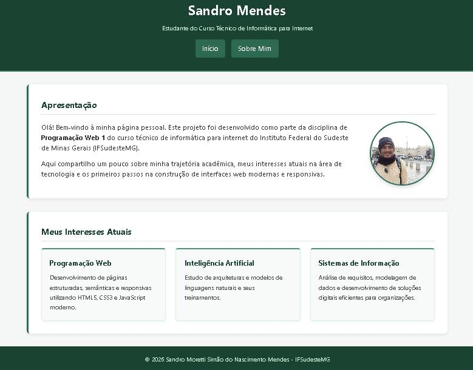
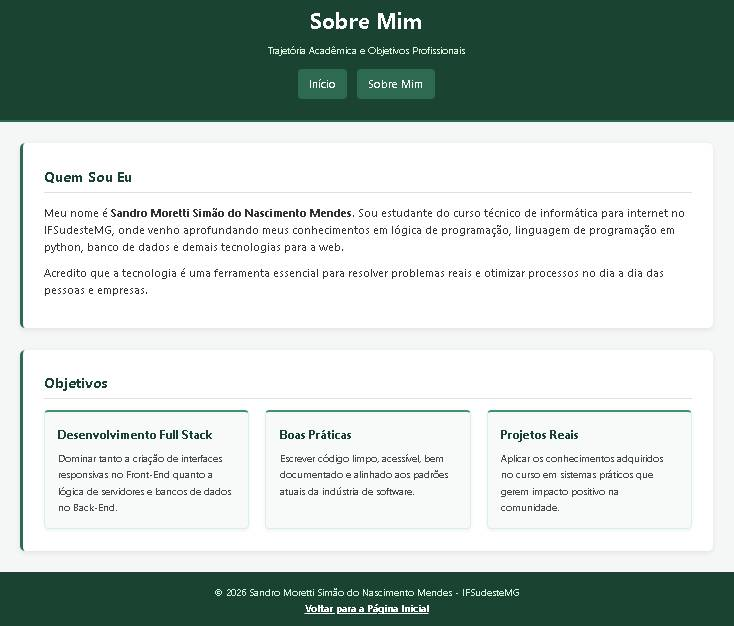
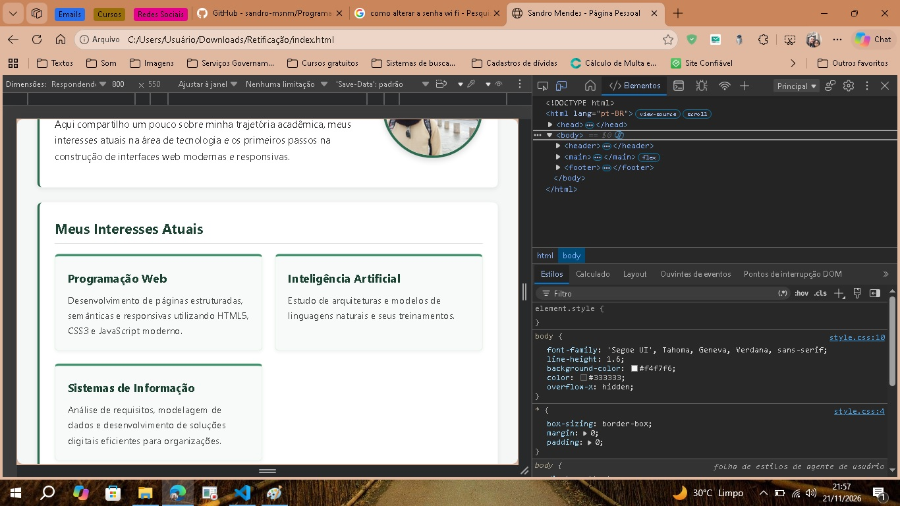

# Minha Página Web Responsiva

**Aluno:** Sandro Moretti Simão do Nascimento Mendes  
**Curso:** Técnico em Informática para Internet — IFSudesteMG  
**Disciplina:** Programação Web 1  

## Sobre a atividade
Aprimoramento da página pessoal desenvolvida anteriormente, aplicando técnicas modernas de **Design Responsivo (Mobile-First)** com CSS3 para garantir que o layout se adapte perfeitamente a smartphones, tablets e computadores.

### Principais recursos implementados:
* **Configuração Viewport e Reset:** Uso de `<meta name="viewport">`, `box-sizing: border-box` e imagens fluidas (`max-width: 100%` e `height: auto`).
* **Unidades Relativas:** Substituição de medidas fixas por `rem` e `%` para maior flexibilidade em diferentes telas.
* **Flexbox e CSS Grid:** Organização dinâmica do menu de navegação, área de apresentação e grade de cartões (*cards*).
* **Media Queries (Mobile-First):**
  * **Smartphones (`< 768px`):** Menu empilhado e exibição de **1 cartão por linha**.
  * **Tablets (`768px` a `1023px`):** Menu horizontal e exibição de **2 cartões por linha**.
  * **Desktops (`>= 1024px`):** Conteúdo centralizado (`max-width`) e exibição de **3 cartões por linha**.

## Acesso às páginas
* [Página Inicial](index.html)
* [Página Sobre Mim](sobre.html)

## Demonstração da Responsividade

### Visão Computador (Desktop >= 1024px)

### Visão Tablet (768px a 1023px)

### Visão Smartphone (< 768px)

